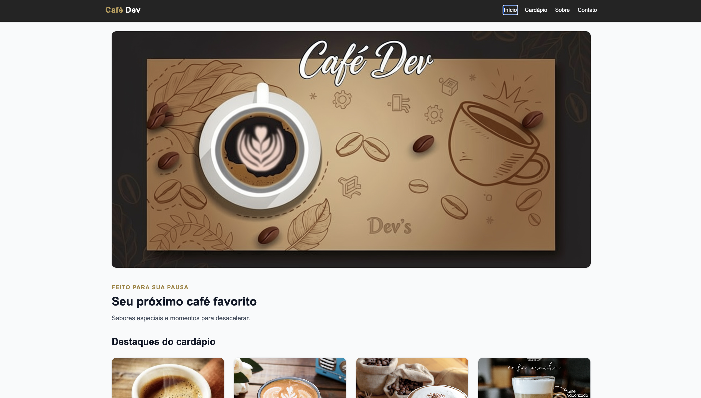
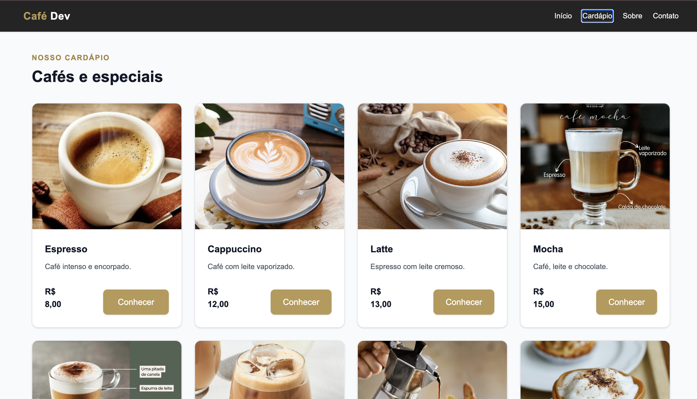

# Café Dev — Cafeteria

Projeto acadêmico desenvolvido para a CP5 da disciplina de Web Development, com o objetivo de criar uma interface web para uma cafeteria utilizando React, Vite e Tailwind CSS.

Página Incial
<p align="center">



</p>

Catálogo de Produtos
<p align="center">



</p>

## Sobre o projeto

O Café Dev apresenta uma interface para divulgação de uma cafeteria e de seus produtos. O design utiliza fundos claros, tons de cinza, elementos escuros e detalhes discretos em dourado.

A aplicação possui uma página inicial com banner de destaque, apresentação de produtos, catálogo e páginas institucionais.

## Funcionalidades

- **Home:** banner principal e produtos em destaque.
- **Produtos:** apresentação do catálogo por meio de cartões reutilizáveis.
- **Sobre:** apresentação da proposta da cafeteria.
- **Contato:** formulário demonstrativo com nome, e-mail e mensagem, incluindo confirmação visual após o envio.
- **Navbar:** navegação entre as páginas.
- **Footer:** informações complementares e navegação no rodapé.
- **Responsividade:** adaptação do layout para diferentes tamanhos de tela.

> Observação: o formulário de contato é demonstrativo e não realiza envio real de e-mails.

## Tecnologias utilizadas

- **React:** criação da interface por meio de componentes reutilizáveis.
- **Vite:** ambiente de desenvolvimento e ferramenta de build.
- **Tailwind CSS:** estilização e construção do layout responsivo.
- **React Router DOM:** navegação entre as páginas, caso esteja instalado e configurado.
- **JavaScript (JSX):** estrutura e lógica dos componentes.
- **Git e GitHub:** versionamento, organização de branches e revisão por Pull Requests.

## Bibliotecas e imports

As bibliotecas externas utilizadas correnpondem às dependências instaladas no projeto.

Imports utilizados:

```jsx
import { useState } from "react"
```

Utilizado no formulário de contato para armazenar os valores digitados e controlar a exibição da confirmação.

```jsx
import { BrowserRouter, Routes, Route } from "react-router-dom"
```

Utilizado para configurar a navegação entre as páginas da aplicação, se essa for a implementação adotada.

Exemplo de import de componente local:

```jsx
import ProductCard from "../components/ProductCard"
```

Permite reutilizar o cartão de produto em diferentes páginas.

## Estrutura de pastas

- `public/images/`: imagens utilizadas na interface.
- `src/components/`: componentes reutilizáveis, como Navbar, Footer e ProductCard.
- `src/pages/`: páginas da aplicação.
- `src/App.jsx`: composição geral e configuração das rotas.
- `src/main.jsx`: inicialização da aplicação React.
- `src/index.css`: estilos globais e configuração de CSS do projeto.
- `integrantes.txt`: identificação dos integrantes e link do repositório.

## Como executar o projeto

### Pré-requisitos

- Node.js e npm instalados.
- Git instalado, caso o repositório seja clonado.

### Instalação

Clone o repositório:

```bash
git clone URL_DO_REPOSITORIO
```

Acesse a pasta:

```bash
cd NOME_DO_REPOSITORIO
```

Instale as dependências:

```bash
npm install
```

```bash
npm install tailwindcss @tailwindcss/vite
```

```bash
npm install react-router-dom
```

Inicie o servidor de desenvolvimento:

```bash
npm run dev
```

O terminal apresentará o endereço local para acessar a aplicação no navegador.

## Identidade visual

A interface utiliza uma composição visual clara, com fundo em tons suaves, textos escuros, cartões brancos e detalhes dourados discretos.

O objetivo é apresentar os produtos de forma organizada, mantendo uma experiência visual consistente entre as páginas.

## Versionamento e colaboração

O desenvolvimento foi organizado em branches e commits, separando a estrutura inicial, a estilização e os refinamentos das funcionalidades.

As features foram encaminhadas para revisão por Pull Requests, com integração na branch de desenvolvimento antes da publicação da versão final.

## Integrantes 💻 

`Alyson Souto`

## Deploy  🌐
Acesso ao projeto: https://alyson-souto.github.io/cafeteria-dev/

